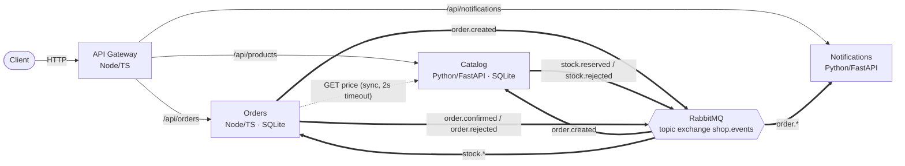

# microshop — microservices with an API gateway and RabbitMQ

A small online shop split into four services that talk over HTTP and events. Placing an order runs a **choreography saga**: the orders service accepts the order as `PENDING`, the catalog reserves stock (or refuses), and the order ends `CONFIRMED` or `REJECTED`. The customer is then notified by email.



| Service | Stack | Owns | Publishes | Consumes |
|---|---|---|---|---|
| **gateway** | Express 5, http-proxy-middleware | — | — | — |
| **orders** | Express 5, Zod, amqplib, `node:sqlite` | orders DB | `order.created`, `order.confirmed`, `order.rejected` | `stock.reserved`, `stock.rejected` |
| **catalog** | FastAPI, aio-pika, SQLite | products + stock DB | `stock.reserved`, `stock.rejected` | `order.created` |
| **notifications** | FastAPI, aio-pika | sent emails (in memory) | — | `order.confirmed`, `order.rejected` |

## Design decisions

- **Database per service.** Orders never reads the catalog's tables. It asks the catalog for prices over HTTP and learns about stock only through events.
- **Saga without an orchestrator.** Each service reacts to events and publishes its own result. If stock runs out, the order is rejected and nothing is charged. There is no distributed transaction.
- **All-or-nothing reservations.** The catalog reserves every line of an order inside one SQLite transaction (`BEGIN IMMEDIATE`). If one item is short, nothing is reserved.
- **Safe redelivery.** RabbitMQ delivers *at least once*, so every consumer is idempotent:
  - the catalog remembers the outcome per order;
  - orders only settles orders that are still `PENDING`;
  - notifications ignores an event it has already handled.
- **No lost events.** Queues are durable and messages persistent. Consumers ack only after handling, so a crash mid-way means redelivery, not loss.
- **Gateway concerns live in one place:**
  - routing by prefix;
  - an `x-request-id` created or propagated to every service, so one order can be traced across logs;
  - JSON access logs;
  - per-IP rate limiting with `RateLimit-*` and `Retry-After` headers;
  - `502` when an upstream is down;
  - an aggregated `/health` that reports `degraded` (503) if any service is down.
- **Failing fast.** If the catalog does not answer within 2 s, orders returns `503` and publishes nothing.

## Observability

Every service exposes the same three signals, so a slow or failed order can be followed end to end.

| Signal | How | Where to look |
|---|---|---|
| **Metrics** | Prometheus format on `/metrics`: request rate, errors and latency per route template, plus business metrics (`shop_orders_created_total`, `shop_orders_settled_total{status}`, `shop_order_saga_duration_seconds`, `shop_stock_reservations_total`, `shop_product_stock`, `shop_notifications_sent_total`) and RabbitMQ queue depth | Prometheus `:9090`, Grafana dashboard *microshop overview* `:3000` |
| **Traces** | OpenTelemetry. HTTP (Express, FastAPI, `fetch`) **and** RabbitMQ (amqplib, aio-pika) are instrumented, so the trace context crosses the broker inside message headers | Jaeger `:16686` |
| **Logs** | One JSON object per line with `service` and `trace_id` | `docker compose logs`, joined to traces by `trace_id` |

One order produces a single trace that goes gateway → orders → catalog (price lookup) → RabbitMQ → catalog (stock) → RabbitMQ → orders → RabbitMQ → notifications.

**Alerts** (`observability/prometheus/alerts.yml`), each covered by a `promtool` unit test:

| Alert | Fires when |
|---|---|
| `ServiceDown` | a target misses scrapes for 1 minute |
| `HighErrorRate` | more than 5% of a service's requests return 5xx for 5 minutes |
| `SlowRequests` | p95 latency is above 500 ms for 10 minutes |
| `OrdersStuckPending` | orders are created but none settle in 10 minutes (the saga is broken) |
| `HighRejectionRate` | more than 20% of orders are rejected for lack of stock |
| `LowStock` | a product has fewer than 3 units |
| `QueueBacklog` | a queue holds more than 100 waiting messages for 5 minutes |

Metric labels use route templates (`/orders/:id`), never raw URLs or IDs, so the number of time series stays bounded. A test checks this.

## Run it

**With Docker** (everything, including RabbitMQ):

```bash
docker compose up --build
# gateway        http://localhost:8080
# Grafana        http://localhost:3000   (dashboard "microshop overview")
# Jaeger         http://localhost:16686  (traces)
# Prometheus     http://localhost:9090   (alerts tab)
# RabbitMQ UI    http://localhost:15672  (guest/guest)
```

**Without Docker** (needs a local RabbitMQ, Python 3.12+ and Node 22+):

```bash
pip install -r catalog/requirements.txt pytest httpx promql-parser pyyaml
(cd orders && npm ci) && (cd gateway && npm ci)
./e2e/run.sh   # starts the four services and runs the end-to-end + observability checks
```

### Try it

```bash
curl localhost:8080/api/products
curl -X POST localhost:8080/api/orders -H 'content-type: application/json' \
  -d '{"customer":"ana@example.com","items":[{"sku":"MN-27","quantity":2}]}'
# → 202 {"id":"…","status":"PENDING",…}
curl localhost:8080/api/orders/<id>                             # → CONFIRMED a moment later
curl 'localhost:8080/api/notifications?to=ana@example.com'      # → the confirmation email
```

There are only 2 monitors (`MN-27`) in stock, so a second order for one ends `REJECTED`, and that customer gets a "ran out of stock" email.

## Tests

| Suite | What it covers |
|---|---|
| `catalog` (pytest, 6) | all-or-nothing reservation, idempotency on redelivery, unknown SKU, published outcome, HTTP API, metrics |
| `notifications` (pytest, 4) | email per event, duplicate events ignored and counted, filtering by recipient |
| `orders` (Vitest, 6) | pricing from the catalog, `order.created` payload, saga settlement + duplicate events, validation, catalog down → 503, metrics without raw IDs |
| `gateway` (Vitest, 7) | routing and path rewrite, request-ID propagation, aggregated health, 502, rate limit, metrics by prefix, 404 |
| `observability/prometheus/alerts.test.yml` | `promtool` unit tests: each alert fires when it should and stays quiet when it shouldn't |
| `observability/check.py` | every PromQL query in alerts and dashboard parses and uses a metric that the services really export |
| `e2e/run.sh` | the four real services + real RabbitMQ: one order confirmed, one rejected, stock decremented once, both emails sent; then metrics on every target, **one trace spanning all four services**, and JSON logs carrying that trace's ID |

Unit tests use an in-memory bus, so they need no broker. In the end-to-end run, traces go to a small OTLP receiver (`e2e/otlp_sink.py`) so the test can inspect them; in Docker they go to Jaeger. CI runs everything above, the alert tests with `promtool`, then `docker compose build`.

## What I'd add next

- An **outbox table** in orders. Saving the order and publishing `order.created` are two steps today; a crash between them would leave a `PENDING` order with no event.
- A **dead-letter queue** with retries and backoff instead of "retry once, then drop".
- **Log shipping** (Loki or the OpenTelemetry Collector) so logs sit next to traces in Grafana.
- **Payment** as a third step of the saga, with a compensating "release stock" event.

## License

MIT
